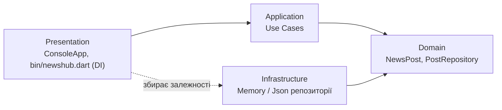

# newshub_clean

Консольний новинний агрегатор. Лабораторна робота №5: шарувата архітектура
(Clean Architecture) і командна робота в Git.

## Архітектура



Залежності спрямовані до центру: Domain не залежить від жодного іншого шару.
Інтерфейс `PostRepository` оголошено в Domain, реалізації лежать в Infrastructure,
Application працює лише з інтерфейсом (принцип інверсії залежностей).

| Шар | Каталог | Вміст |
|---|---|---|
| Domain | `lib/src/domain` | `NewsPost`, `PostCategory`, `PostRepository` |
| Application | `lib/src/application` | `PublishPostUseCase`, `GetPostsUseCase`, `ToggleSavedUseCase` |
| Infrastructure | `lib/src/infrastructure` | `MemoryPostRepository`, `JsonPostRepository` |
| Presentation | `lib/src/presentation`, `bin` | `ConsoleApp`, точка входу з DI |

## Збірка і запуск

1. Встановити Dart SDK версії 3.0 або новішої (входить до складу Flutter).
2. Клонувати репозиторій:
   ```
   git clone https://github.com/olenaishchuk/newshub_clean.git
   cd newshub_clean
   ```
3. Завантажити залежності:
   ```
   dart pub get
   ```
4. Запустити:
   ```
   dart run bin/newshub.dart
   ```

Спосіб зберігання даних задається у `config/settings.json`:
`"storage": "memory"` (у пам'яті) або `"storage": "json"` (файл, шлях у `dataFile`).

## Git-процес

- `main`: стабільний код, релізи позначені тегами (`v1.0.0`);
- `develop`: інтеграційна гілка;
- `feature/*`: гілки під окремі задачі, зливаються в `develop` через Pull Request.

Повідомлення комітів: Conventional Commits (`feat`, `fix`, `docs`, `chore`, `merge`).